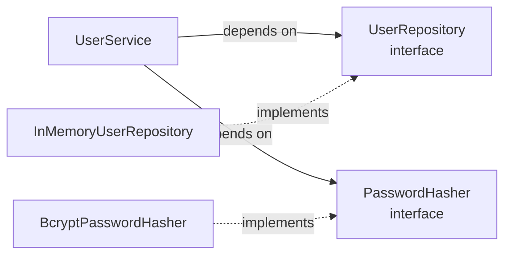

# Auth Service

A reusable user authentication module for registering users and verifying their credentials. Passwords are hashed with bcrypt, a password policy is enforced, and every registration and login attempt is logged. The module was built with strict Test-Driven Development and has 100% statement and branch coverage.

## Setup

Requires Python 3.11+.

```bash
git clone https://github.com/B-Pine/auth-service.git
cd auth-service
python -m venv .venv
.venv\Scripts\activate          # Windows
source .venv/bin/activate       # macOS / Linux
python -m pip install -r requirements.txt
python -m pre_commit install
```

> **Windows Application Control:** if `pip.exe` or other tools in `.venv\Scripts` are blocked, run them through Python (`python -m pip`, `python -m pytest`, `python -m mypy`). If mypy's compiled files are blocked, install its pure-Python build: `python -m pip install --no-binary mypy mypy==1.11.2`.

## Installing in another project

```bash
pip install git+https://github.com/B-Pine/auth-service.git@v1.0.0
```

bcrypt is installed automatically as a dependency.

## Usage

```python
from auth.hashers.bcrypt_password_hasher import BcryptPasswordHasher
from auth.repositories.in_memory_user_repository import InMemoryUserRepository
from auth.services.user_service import UserService

service = UserService(
    repository=InMemoryUserRepository(),
    hasher=BcryptPasswordHasher(),
)

user = service.register("alice", "correct-horse")
print(user)                                   # User(username='alice')

user = service.login("alice", "correct-horse")
```

`User` leaves its password hash out of its printed form, so printing or logging a user never reveals it.

### Errors

```python
from auth.exceptions import InvalidPasswordError, UserNotFoundError

try:
    service.login("alice", "wrong-password")
except (UserNotFoundError, InvalidPasswordError):
    print("Invalid username or password")
```

| Exception | Raised by | When |
|---|---|---|
| `InvalidPasswordError` | `register` | The password is shorter than 8 characters or longer than 72 bytes |
| `UserAlreadyExistsError` | `register` | The username is already taken |
| `UserNotFoundError` | `login` | No user has the username |
| `InvalidPasswordError` | `login` | The password is wrong |

All inherit from `AuthError`. When showing login failures to end users, catch `UserNotFoundError` and `InvalidPasswordError` together and show one message, as above, so that the response does not reveal which usernames exist.

### Logging

Every registration and login attempt is logged in a `key=value` format. Failures are warnings with a reason:

```
login failed username=alice reason=wrong_password
login failed username=bob reason=unknown_user
registration rejected username=bob reason=weak_password
```

As a library, the module does not configure logging. Python shows warnings by default; to also see successful events, call `logging.basicConfig(level=logging.INFO)` in your application. Passwords and hashes are never logged.

## Architecture



`UserService` holds the rules of registration and login. It never creates its dependencies: a repository and a hasher are passed in when it is created, and it knows them only through their interfaces.

| Component | Responsibility |
|---|---|
| `UserService` | Registration and login rules, and logging of every attempt |
| `UserRepository` | Interface: store users and find them by username |
| `InMemoryUserRepository` | Keeps users in a dictionary |
| `PasswordHasher` | Interface: hash passwords and verify them |
| `BcryptPasswordHasher` | Salted bcrypt hashing with a configurable cost (default 12) |
| `validate_password` | The password policy |
| `User` | Frozen dataclass: username and password hash |

### SOLID in this design

| Principle | Where it shows |
|---|---|
| Single Responsibility | Each class has one job: the service applies rules, the repository stores, the hasher hashes, the validator holds the policy |
| Open/Closed | New storage or hashing is added by writing a new class, without changing the service |
| Liskov Substitution | Any repository or hasher implementing the interface can replace another; the same service tests pass with mocks and with the real classes |
| Interface Segregation | The two interfaces are small and separate: a hasher does not need to know about storage |
| Dependency Inversion | `UserService` depends on the `UserRepository` and `PasswordHasher` abstractions, never on the concrete classes |


## Security notes

- **Passwords are never stored.** Only bcrypt hashes are kept. Each hash has a random salt, so identical passwords produce different hashes.
- **Slow hashing on purpose.** The default bcrypt cost of 12 makes each guess expensive for an attacker. Tests use a cost of 4 for speed.
- **72-byte limit.** bcrypt only uses the first 72 bytes of a password, so longer passwords are rejected by the policy. The limit is in bytes: accented letters and symbols count as more than one.
- **Damaged hashes fail closed.** A malformed stored hash never verifies.
- **No secrets in logs.** A test checks that passwords and hashes never appear in log output at any level.
- **Known limitation: timing.** A login for an unknown username returns faster than one with a wrong password, because no hash is checked. Response times could therefore reveal which usernames exist. A fix would run a dummy bcrypt check for unknown usernames.

## Testing

```bash
python -m pytest                                                     # run the tests
python -m pytest --cov --cov-report=term-missing --cov-report=html   # with coverage
python -m mypy .                                                     # strict type check
```

**Coverage: 100% statement and branch coverage across 39 tests,** enforced by `fail_under = 100` in `pyproject.toml`. The latest report is in [`docs/coverage-report.txt`](docs/coverage-report.txt).

## Development process

Every behaviour was written test-first, following Red-Green-Refactor, and the commit history shows each stage: `test(red):` for a failing test, `feat(green):` for the minimum code to pass it, `refactor:` for structural improvements with all tests passing, and `test:` for tests that passed immediately because the behaviour already existed.

The project follows Git Flow: features are developed on `feature/*` branches and merged into `develop` through pull requests, each with a review, and releases reach `main` through `release/*` branches. Pull requests are merged with merge commits so that the TDD history stays visible.